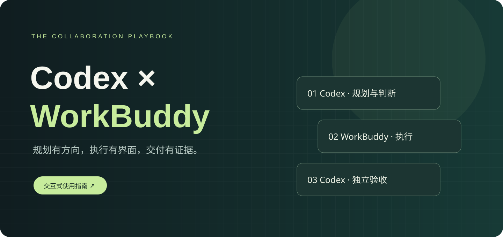

# Codex × WorkBuddy

**让规划、执行与验收形成闭环。** 一个按项目绑定真实桌面 WorkBuddy 会话的 Codex skill，附可离线使用的交互指南。

## 从这里开始

- [交互式使用指南](docs/index.html)：下载后双击打开，支持安装检查、流程演示、任务提示词生成与排障。GitHub 文件页只展示源码，不直接渲染 HTML。
- [Skill 入口](skills/workbuddy-executor/SKILL.md)
- [首次连接说明](skills/workbuddy-executor/references/setup.md)
- [项目绑定示例](examples/project-binding.example.json)

**依赖说明：本仓库不是 WorkBuddy Gateway。** 它不包含桥接服务、MCP 服务端、依赖或任何账号资料。已有兼容 Gateway 才能真实派工；没有 Gateway 时可阅读指南、安装 skill、准备任务，但不能完成连接。没有已核实的公开 Gateway 下载入口，本仓库不提供猜测链接。

## 安装 skill

下载本仓库，将 `skills/workbuddy-executor` 整个目录复制到 Codex 的 skills 目录，默认 Windows 为 `%USERPROFILE%/.codex/skills/`，macOS/Linux 为 `~/.codex/skills/`。使用自定义 CODEX_HOME 时放到其 skills 目录。已有同名版本先备份，不覆盖私人配置。

重新加载 skills 或打开新对话，在已配置 Gateway 的环境中输入：

> 使用 $workbuddy-executor，把这个项目交给我指定的 WorkBuddy 空间。先核对目录、显示会话与模型，等我确认本轮模型后派工；整批完成再独立验收。

## 协作方式

Codex 规划和判断 → 绑定项目/会话 → 用户确认模型 → WorkBuddy 执行、自测、回报 → Codex 核真实成果 → 验收或集中返工。

- 每个项目有自己的 workspace、sessionId 与授权成果根。
- 状态未知先恢复原编号，不重复派工；排队和领取均不等于完成。
- 返工与换会话需要新的本轮模型确认。
- 检查点脚本是可选高级功能，依赖兼容 Gateway 内部 API；不精确检测 token，不自动唤醒退出的 Codex。

## 验证

需要 Node.js；在仓库根运行 `node --test skills/workbuddy-executor/scripts/context-relay.test.mjs`。这些是保护逻辑测试，不证明某台机器的真实桌面桥接已可用。本发行不重复引用个人环境的历史测试数量作为公开版验证结论。

## 公开范围

本版本从本机 skill 整理而来，移除了个人项目映射、真实路径、会话标识和权限历史。原本机 skill 保持不变。不包含 `.env`、Cookie、令牌、原生会话数据库或业务材料。公开共享不代表 WorkBuddy 或 OpenAI 官方发布；名称用于说明兼容产品。

尚未指定开源许可证；公开可见不代表已授予任意复制、修改与再分发许可。如需开源授权，请由权利人选择适当许可证后再增加 LICENSE。
